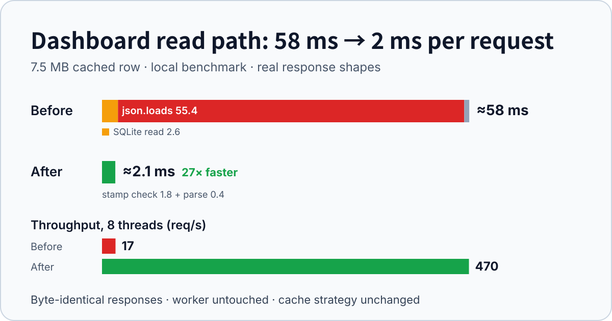
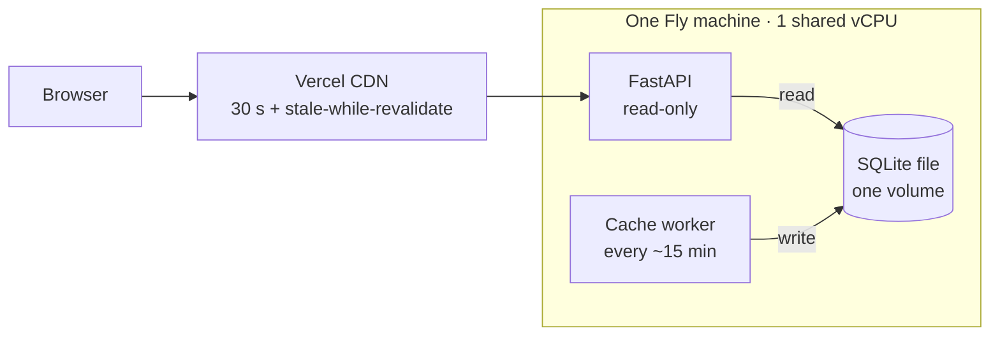
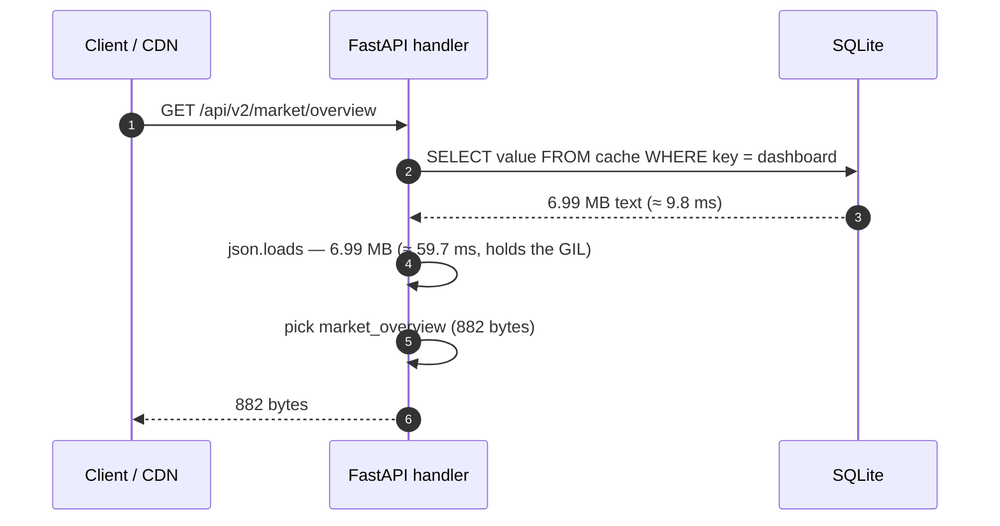
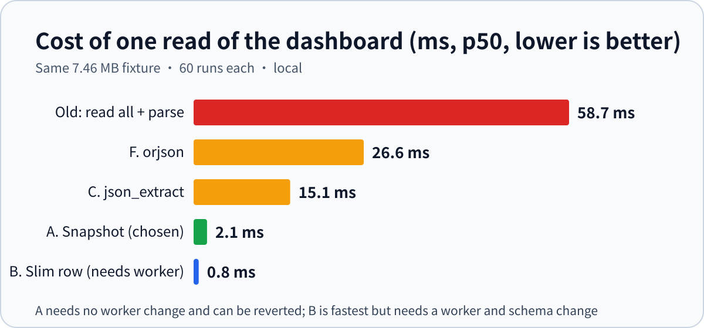
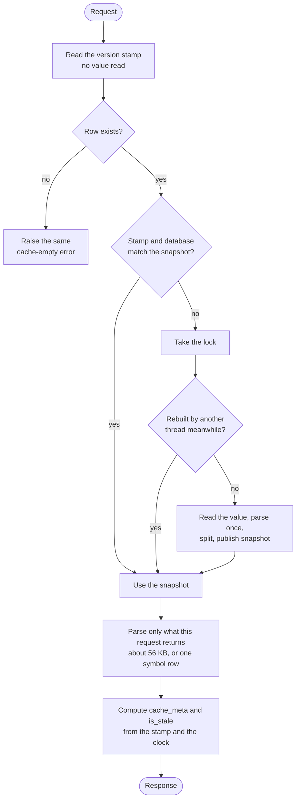
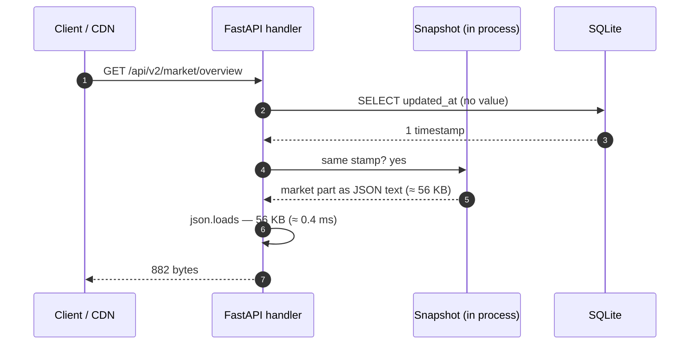

# Seven Megabytes per Request: Fixing a 58 ms Hot Path with a Snapshot

**Date:** October 17, 2026  
**Author:** Xing @ [XingAI](https://xingai.app)  
**Project:** Invest AI  
**Tags:** `invest-ai` `performance` `cqrs` `sqlite` `fastapi` `caching` `benchmark` `testing`  
**Also available:** [中文](2026-10-17-invest-ai-dashboard-snapshot-seven-megabyte-row.zh.md)

---



An endpoint that returned **882 bytes** took as long as one that returned **52 KB**. That was the clue. The time was not in the response. It was in a cache row that every request read and parsed in full: **7 MB of JSON, to answer with a few kilobytes**.

This post is the whole story: how we found it, what we measured, the options we rejected, the fix, how we proved the output did not change, and what is still left. It is written so you can reuse the method on your own service. The numbers come from real runs; where a number is derived or not yet measured in production, it says so.

> **TL;DR**
> - Thirteen dashboard routes each read and parsed a **6.99 MB** cached row per request (9.8 ms read + 59.7 ms parse, measured on the production machine), even when they returned under 1 KB.
> - The API now keeps one snapshot per worker write, validated by a sub-millisecond version stamp. Per-request service time: **57.7 ms → 2.1 ms (27×)**; 8-thread throughput **17 → 470 req/s**; output **byte-identical**; the worker is untouched.
> - It is a *read-path* change. It does not touch the worker/cache boundary ([ADR-012](https://github.com/xingaiapp/xingai-invest-ai/blob/main/docs/adr/012-decision-cache-boundary.md)) or the cache strategy.
> - Production numbers for after the deploy are not in yet; section 8 says exactly what is measured and what is derived.

## 1. Where this sits

Invest AI follows the CQRS pattern from [ADR-008](https://github.com/xingaiapp/xingai-invest-ai/blob/main/docs/adr/008-cqrs-cache-pattern.md): a background worker computes and writes cache rows; FastAPI only reads them. The earlier post, [Shared CPU, Shared SQLite](./2026-09-30-invest-ai-console-cdn-parallel-auth-ohlcv.md), covered the edge cache and the write side. This one is about the *read* side, one layer down.



Two facts about this box matter for everything that follows:

1. **One shared vCPU** runs the API and the worker. CPU the API burns is CPU the worker does not get.
2. The API is Python. Its sync handlers run in a thread pool, but pure-Python work such as `json.loads` holds the GIL, so threads do not add throughput for CPU-bound requests.

## 2. The symptom: latency that ignored payload size

We hit the production origin directly (bypassing the CDN) five times per route and recorded time-to-first-byte:

| Route | Response size | TTFB (origin) | Reads the dashboard row? |
|---|---:|---:|:---:|
| `/api/v2/dashboard` | 51.7 KB | 119–150 ms | yes |
| `/api/v2/market/overview` | **0.9 KB** | **115–134 ms** | yes |
| `/api/v2/engines/votes` | 2.6 KB | 110–131 ms | yes |
| `/api/v2/watchlist` | 30.5 KB | 108–161 ms | yes |
| `/api/v2/signals/top` | 1.9 KB | 105–134 ms | yes |
| `/api/v2/market/bars/catalog` | 30.7 KB | 47–55 ms | no |
| `/api/v2/ai-map` | **202 KB** | **51–56 ms** | no |

(About 50 ms of every row is network from where we measured. The two “no” routes are the floor.)

Read the table the other way round: the **largest** response, `/ai-map`, is among the **fastest**; the **smallest**, `market/overview`, is among the **slowest**. If latency tracked bytes, it would be the opposite. So the cost was a *fixed* ~65–80 ms that every dashboard-derived route paid before it did anything route-specific.

The CDN hid this for repeat visitors (a configured route goes `MISS` then `HIT`). It did not hide it for the first visitor after each 30-second window, for crawlers, or for the CPU the miss consumed on the shared vCPU.

## 3. Finding it: a hypothesis ladder

We did not guess. We wrote the suspects down and killed them one by one, cheapest test first.

| # | Suspect | How we tested | Verdict |
|---|---|---|---|
| 1 | Pydantic `response_model` validation and serialization is slow | Ran FastAPI's own `serialize_response` on real payloads fetched from the live API | **No.** +0.72 ms (dashboard), +0.48 (watchlist), +0.34 (bars catalog), +0.10 (overview, votes) |
| 2 | Network or CDN | Compare against routes that skip the dashboard row (`ai-map`, bars catalog) | **No.** Those are ~50 ms for 30–200 KB |
| 3 | SQLite read | Read-only timing script on the production machine | **Part.** 9.8 ms for this row, 0.4 ms for a small one |
| 4 | JSON parsing | Same script, `json.loads` on the same row | **Yes.** **59.7 ms** |

Then we asked why the row was slow, and looked at what was in it:

| Part of the row | Bytes | Share | |
|---|---:|---:|---|
| `symbol_dashboards` (one snapshot per symbol) | 6,925,181 | **99.1 %** | `████████████████████████████████████████` |
| `watchlist` | 37,061 | 0.5 % | `▏` |
| `macro_radar` | 6,591 | 0.1 % | `▏` |
| `today_intelligence` | 5,181 | 0.1 % | `▏` |
| everything else | 11,478 | 0.2 % | `▏` |
| **Total** | **6,985,492** | 100 % | |

**99.1 % of the row is `symbol_dashboards`**: one full snapshot per tracked symbol, there so `?symbol=NVDA` can be answered from cache. The routes that return the *market* view, which is most of them, never touch that part. They paid to parse 6.9 MB and then threw it away.

Parsing it also costs memory: the parsed object added about **20.6 MB** of resident memory on the production process, allocated and freed per request.

### The old request, drawn out



Where the time went, per request (production machine for steps 1–2, local for the rest, 7.5 MB fixture):

| Step | Time |
|---|---:|
| SQLite read of the 7 MB value | 9.8 ms (prod) / 2.6 ms (local) |
| `json.loads` of the 7 MB value | **59.7 ms** (prod) / **55.4 ms** (local) |
| Select scope, add cache metadata (dict copies) | < 0.01 ms |
| Render a 52 KB response | 0.5 ms |

The parse is ~85 % of the cost. Everything else in the request is noise next to it.

### Why it hurt more than 60 ms suggests

We measured throughput with 1, 4, 8 and 16 threads calling the same service method:

| Threads | Old (req/s) | New (req/s) |
|---:|---:|---:|
| 1 | 17.3 | 452.7 |
| 4 | 17.4 | 463.0 |
| 8 | 17.3 | 469.7 |
| 16 | 17.2 | 456.1 |

The old column is **flat**. Adding threads added nothing: that is the GIL, and the signature of CPU-bound work. One machine could serve about 17 of these per second no matter how the requests arrived, and while it did, the worker shared that CPU. A burst of CDN misses (several routes expiring together, a crawl) turns directly into queueing.

## 4. The options we considered

The constraints came first, because they eliminate options:

1. **Do not change the worker/API boundary.** The worker computes and writes; the API reads ([ADR-012](https://github.com/xingaiapp/xingai-invest-ai/blob/main/docs/adr/012-decision-cache-boundary.md)). No decision logic moves into a request.
2. **Response bytes must not change.** Clients, the CDN and the OpenAPI contract stay as they are.
3. **Performance must never regress, and the cache strategy stays.**
4. **Memory is tight** on a 1 GB machine shared with the worker (the worker died once on a 512 MB machine, most likely out of memory, [ADR-047](https://github.com/xingaiapp/xingai-invest-ai/blob/main/docs/adr/047-worker-process-supervision.md)).

We benchmarked each candidate on the same 7.46 MB fixture (real response shapes from the live API, replicated to production size; 60 runs each):



| Option | p50 | Worker change? | Verdict |
|---|---:|:---:|---|
| **Old** (read all, `json.loads`, select) | 58.7 ms | no | The problem |
| **F.** Faster parser (`orjson.loads`) | 26.6 ms | no | 2.2× better, 13× slower than the fix |
| **C.** Slice in SQL (`json_extract`) | 15.1 ms | no | 3.9× better, still 7 MB per request |
| **D.** Bigger VM | n/a | no | Does not fix a single-threaded parse |
| **E.** Cache each route's output | ~0 ms | no | Fast, but request-time fields cannot be frozen |
| **B.** Worker writes slim rows | 0.8 ms | **yes** | Best shape, biggest project |
| **A.** Snapshot in the API process | **2.1 ms** | no | **Chosen**: 27×, reversible |

Why each one lost:

- **F, a faster parser.** `orjson` is 2.2× quicker, but every request still parses all 7 MB and we gain a native dependency. It would turn a 58 ms problem into a 27 ms one.
- **C, slicing in SQL.** `json_extract(value, '$.market_overview')` still scans the whole document for every request, needs a path per route, and couples the API to the row layout the worker owns.
- **D, a bigger VM.** More RAM does nothing for CPU-bound work. An extra vCPU would ease the contention with the worker, but one process still parses on one thread under the GIL.
- **E, caching each route's output.** It multiplies cached objects by route × scope, and `is_stale` and the cache metadata depend on *request time*, so outputs cannot simply be frozen. Caching the *input* keeps that logic unchanged.
- **B, slim rows written by the worker.** The best long-term shape (the market part as its own ~56 KB row, 0.8 ms). It needs a coordinated change to the worker, the cache layout and the reader, so it is a project, not a fix.

We chose **A now and keep B as the follow-up**: A needs no coordination between the two processes and can be reverted by deleting one class; B is better, but it changes the worker and the schema.

## 5. The design

The idea: parse **once per worker write** instead of once per request, and answer each request from a small, request-private copy.

### Lifecycle



### The new request



### Decisions that matter

| Decision | Why |
|---|---|
| **Key the snapshot on `updated_at` plus the database path** | `cache_set` stamps `time.time()` on every write, and the worker writes this row without an explicit stamp (checked in the worker code). The path stops two databases (tests, or a changed `DATABASE_URL`) sharing a snapshot. |
| **Store serialized JSON, not parsed objects** | Each request parses its own small copy, so no caller can mutate shared state. A parsed copy would also hold ~20.6 MB of Python objects; the serialized snapshot holds **7.5 MB**. |
| **Split once: the market part, plus each symbol row separately** | A market request parses ≈ 56 KB; a `?symbol=` request parses one row. Neither touches the other 6.9 MB. |
| **Keep staleness per request** | `is_stale` depends on *now* minus the row's stamp. It is recomputed on every request from the snapshot's timestamp, so the 15-minute rule behaves exactly as before. |
| **Rebuild under a lock with a second check** | After a worker write, one thread rebuilds (~124 ms) and the rest wait for that result instead of each parsing 7 MB. |
| **Keep the original selection code** | `_select_cached_scope` stays in the class unchanged. It is the *reference* the tests compare the new path against. |
| **Do not use `response_model` on big cached payloads** | We measured it (+0.1–0.7 ms on 30–50 KB), but at 200 KB it would add a few ms for no benefit, so the new public-research models are documentation only. |

The core of it, trimmed:

```python
@dataclass(frozen=True)
class _Snapshot:
    db_path: str
    updated_ts: float
    market_json: str                                   # payload minus "symbol_dashboards"
    has_symbol_dashboards: bool
    symbol_rows: dict[str, tuple[str, bool, bool]]     # key -> (json, truthy, is_dict)

def _current_snapshot(self) -> _Snapshot:
    stamp = cache_updated_at(V2_DASHBOARD_CACHE_KEY)   # sub-millisecond, no value read
    if stamp is None:
        raise RuntimeError("v2 dashboard cache is empty; run the market cache worker")
    snap = self._snapshot
    if snap and snap.updated_ts == stamp and snap.db_path == db_path:
        return snap                                    # hit: no 7 MB read, no parse
    with self._snapshot_lock:
        snap = self._snapshot                          # second check under the lock
        if snap and snap.updated_ts == stamp and snap.db_path == db_path:
            return snap
        raw, updated_ts = cache_get(V2_DASHBOARD_CACHE_KEY)
        self._snapshot = self._build_snapshot(raw, updated_ts, db_path)
        return self._snapshot
```

One subtle detail is worth calling out. The original code picked a symbol row with `snapshots.get(sym) or snapshots.get(normalized)`. That `or` means an *empty* row falls through to the normalized key. A serialized copy loses Python truthiness, so the snapshot stores `(json, truthy, is_dict)` per row and the selector reproduces the same fall-through.

## 6. Proving the output did not change

A performance fix that changes answers is a bug. We tested for equality three ways, and tested the tests.

### The test suite for the snapshot (10 tests)

| Test | What it proves |
|---|---|
| every scope matches the original selection exactly | `None`, blank, `NVDA`, `nvda`, ` spy `, `^GSPC`, an empty row, a non-dict row and a missing symbol give byte-identical JSON (or the same error text) to the original algorithm |
| symbol scope disabled / no symbol table | the config switch and the missing-table case behave as before |
| private `symbol_dashboards` never leaks | the 6.9 MB internal field never appears in any response |
| value is read once per worker write | 75 requests over three scopes cause **one** `cache_get` |
| a new worker write is served on the next request | invalidation works |
| missing row raises the same error and recovers | same message, then works once the worker writes |
| callers cannot corrupt the snapshot | mutate a response deeply, the next response is unaffected |
| staleness is computed per request | with the clock moved past 15 minutes the same snapshot reports `is_stale` and “Stale Mode” |
| 12 concurrent readers during a write | every answer is complete and from a single write (never half old, half new) |
| two databases never share a snapshot | switching `DATABASE_URL` does not serve the other database's data |

### Equality at production scale

The benchmark harness also runs the old and new service on the 7.5 MB fixture and compares serialized output for **138 inputs** (every symbol, lower-case variants, a caret symbol, blank and unknown inputs) and **all 11 service methods**: **0 mismatches**.

### Testing the tests (mutation checks)

A passing test only matters if it can fail. We broke the code on purpose:

| Deliberate bug | Caught by | Result |
|---|---|---|
| Snapshot never invalidates (stale forever) | “a new worker write is served on the next request” | caught |
| Callers get shared parsed objects (no copy) | “callers cannot corrupt the snapshot” | caught |
| Stamp always looks changed (rebuild every request) | “value is read once per worker write” | caught |

Our first attempt at the first bug did not fail, and that was instructive: forcing the stamp to a constant did not serve stale data; it made the code rebuild every time, which is *correct but slow*. Behavior tests do not catch “correct but slow”; the read-once test does. We kept both.

### Everything else

- The full backend suite is **506 tests**, run on two FastAPI versions (0.136.1 locally and 0.143.3 from a fresh install). Both pass.
- CI (backend, frontend and worker jobs) is green on the pushed commit.
- The request-path boundary test, which fails if any provider or LLM client is imported by the API, still passes: the change adds no import.

## 7. Results

Local benchmark, 7.46 MB fixture (real shapes from the live API, replicated to production size), 60 runs per case, same machine, old code taken from the previous commit:

| Case | Old p50 | Old p95 | New p50 | New p95 | Speed-up |
|---|---:|---:|---:|---:|---:|
| `get_dashboard()` market scope | 57.7 ms | 59.8 ms | 2.1 ms | 2.7 ms | **27.1×** |
| `get_dashboard("NVDA")` | 57.6 ms | 60.3 ms | 2.6 ms | 3.4 ms | **21.9×** |
| `get_market_overview()` (0.9 KB out) | 57.4 ms | 60.0 ms | 2.1 ms | 2.8 ms | **27.3×** |
| `get_watchlist()` (30 KB out) | 57.7 ms | 60.0 ms | 2.0 ms | 2.4 ms | **28.5×** |

| Other measures | Old | New |
|---|---:|---|
| 8-thread throughput | 17.3 req/s | **469.7 req/s** |
| Memory held | 0 (but ~20.6 MB allocated and freed per request) | 7.5 MB |
| First request after a worker write | 58 ms (like every request) | 124 ms, once per write (~every 15 min) |
| Response bytes | — | identical |
| Worker / schema changes | — | none |

### Where the new 2.1 ms goes

| Part of the new request | Time | Share | |
|---|---:|---:|---|
| Version stamp read | 1.8 ms | 82 % | `█████████████████████████████████` |
| Parse the 56 KB part | 0.4 ms | 18 % | `███████` |

This is the honest part: after the fix, **the stamp check is 80 % of the remaining time**. It is a one-column read, so why 1.8 ms? Because of how SQLite lays out a row: `updated_at` is stored *after* the 7 MB `value` column, and to reach it SQLite walks the value's overflow-page chain (about 1,700 pages of 4 KB). On the production machine, the same `SELECT updated_at` takes **2.56 ms** on the 7 MB row versus **0.40 ms** on a 287 KB row, and opening and closing the connection costs 0.03 ms. So we expect roughly **3 ms** per request in production (derived from those parts, not yet measured end to end), still about 20× better than the ~70 ms it replaces.

## 8. What we have not measured yet

We would rather list gaps than hide them.

- **Production end-to-end numbers.** The change is merged but not yet deployed when this was written. The “before” numbers above are measured at the production origin; the “after” ones are local plus the derived ~3 ms. We will add the deployed origin TTFB for the same seven routes here.
- **The fixture is synthetic in scale.** Shapes and sizes come from the live API (52 KB per symbol row, 130 rows ≈ 7.46 MB vs. the real 6.99 MB), but the values are copies. Parse time depends on size and structure, which match; we do not expect a different result, and the production read-only timings (9.8 ms, 59.7 ms) agree with the local ones (2.6 ms, 55.4 ms) on the parse, which is the dominant term.
- **First-request-after-write cost.** One request per worker write pays ~124 ms (vs. 58 ms before). Others wait for the lock during that time, which is bounded by the rebuild. The CDN's stale-while-revalidate shields users from it.
- **Memory under real load.** 7.5 MB is the snapshot size; we have not watched RSS over days.

## 9. What we did not do, and what comes next

| Not done | Why |
|---|---|
| Change the worker | Option B is better long term, but it needs a coordinated worker, schema and reader change |
| Cache outputs per route | `is_stale` and metadata depend on request time; caching inputs keeps that logic unchanged |
| Add a faster JSON library | Still a 7 MB parse per request, and a new native dependency |
| Touch the CDN rules | They already work (`MISS` then `HIT`); this fixes what happens on a miss |

Next, in order of value:

1. **Remove the stamp-check floor** (about 80 % of what is left). Options: coalesce stamp checks for a few hundred milliseconds in process (bounded staleness far below the 15-minute data cadence), or have the worker write a tiny companion row with the stamp. The first needs no worker change.
2. **Option B**: the worker writes the market part as its own small row; the API reads it directly and the 7 MB row is only read for `?symbol=`. This also removes the rebuild spike.
3. **Pin FastAPI.** While testing this we found the route-inventory test passed locally and failed in CI because a newer FastAPI nests included routers differently. Dependencies are unpinned (`fastapi>=0.111,<1`), so a rebuilt image can pick up a newer version than the tests last ran on.
4. **Server-Timing headers** on the dashboard routes, so the next regression is visible from the browser instead of from a hunch.

## 10. A playbook you can reuse

1. **Plot latency against response size across routes.** If a tiny response is as slow as a big one, you have a fixed cost, not a serialization cost.
2. **Time the suspects separately, cheapest first.** Framework validation (`serialize_response`), network (compare with routes that skip your suspect), storage read, parse.
3. **Measure on the real box, read-only.** A 30-line script that imports your service code and times its calls is enough. It found the 7 MB row in minutes.
4. **Look at what is *in* the big thing.** `json.dumps(v)` per top-level key took one line and showed 99.1 %.
5. **Write the constraints before the options.** Ours removed three of the seven options before we benchmarked.
6. **Keep the old code as the test oracle.** Compare outputs for many inputs, not a few.
7. **Break your own code.** If a test cannot fail, it is not a test. If your regression is “slower” rather than “wrong”, you need a test that counts reads.
8. **Report what you have not measured.** It makes the numbers you did measure more believable.

## Links

- Earlier post: [Shared CPU, Shared SQLite](./2026-09-30-invest-ai-console-cdn-parallel-auth-ohlcv.md)
- [ADR-008 CQRS cache pattern](https://github.com/xingaiapp/xingai-invest-ai/blob/main/docs/adr/008-cqrs-cache-pattern.md) · [ADR-012 Decision cache boundary](https://github.com/xingaiapp/xingai-invest-ai/blob/main/docs/adr/012-decision-cache-boundary.md) · [ADR-056 Console read path](https://github.com/xingaiapp/xingai-invest-ai/blob/main/docs/adr/056-console-read-path-cdn-parallel-auth.md)
- Product: https://invest.xingai.app

Disclaimer: informational engineering notes. Benchmarks are from our environment and will differ in yours. Not investment, legal, or operational advice for your deployment.
