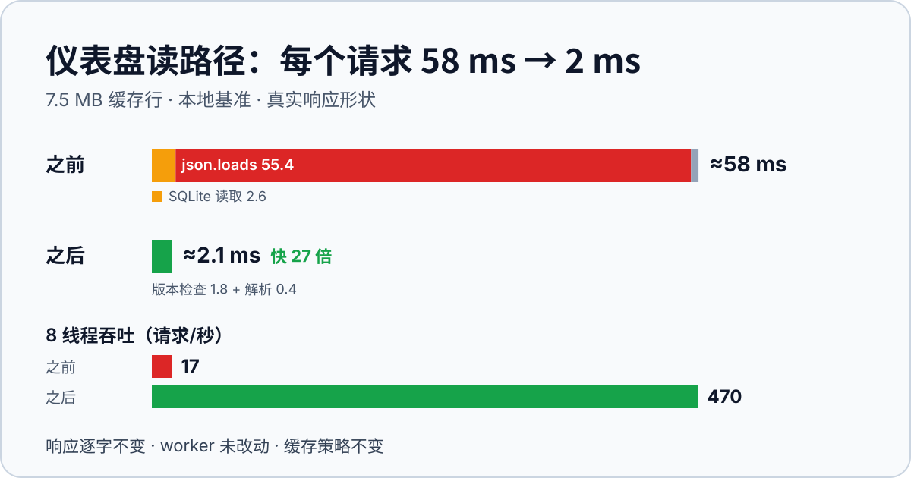
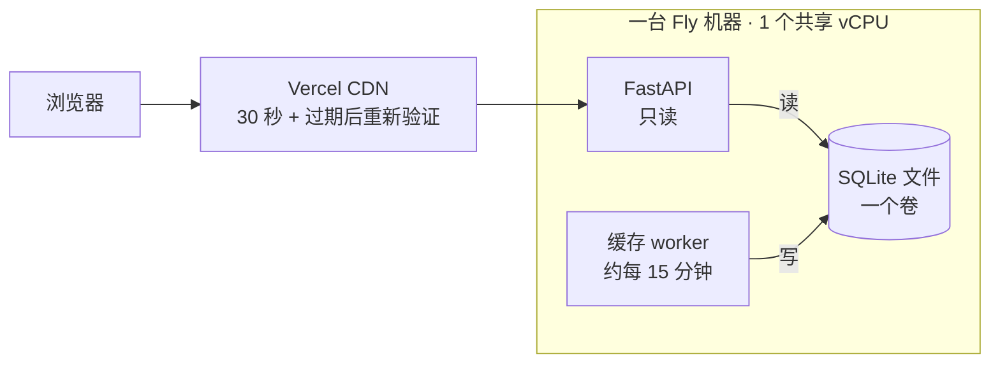
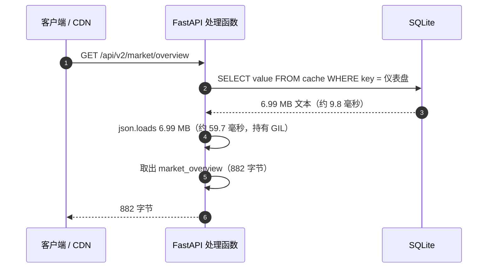
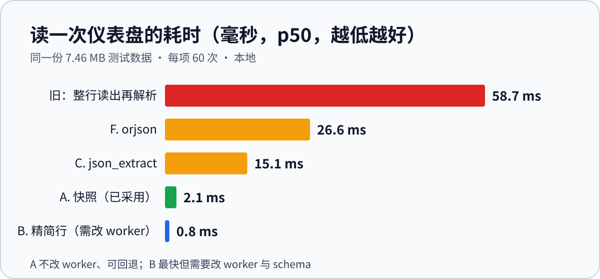
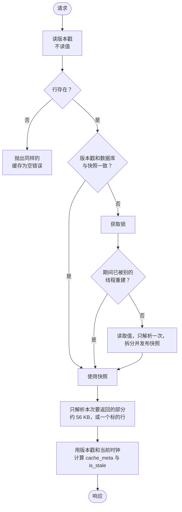
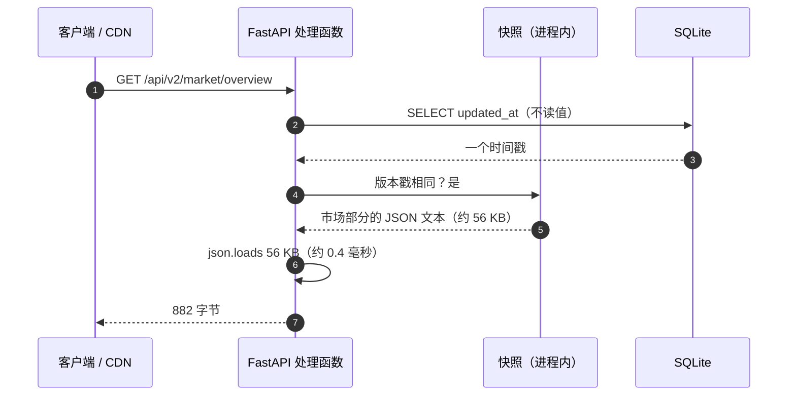

# 每个请求 7 MB：用快照修复 58 毫秒的热路径

**日期：** 2026-10-17  
**作者：** Xing @ [XingAI](https://xingai.app)  
**项目：** Invest AI  
**标签：** `invest-ai` `performance` `cqrs` `sqlite` `fastapi` `caching` `benchmark` `testing`  
**英文：** [English](2026-10-17-invest-ai-dashboard-snapshot-seven-megabyte-row.md)

---



一个只返回 **882 字节** 的接口，和一个返回 **52 KB** 的接口一样慢。这就是线索：时间不是花在响应上，而是花在一行缓存上，每个请求都把它完整读出来、完整解析：**为了回几 KB 的数据，要解析 7 MB 的 JSON**。

这篇文章讲完整个过程：怎么发现的、测了什么、否掉了哪些方案、最后怎么改、怎么证明输出没变，以及还剩什么。写成这样，是想让你能把同一套方法用在自己的服务上。数字都来自真实运行；凡是推算出来的、或还没在生产上测过的，文中都会明说。

> **一句话版本**
> - 十三个仪表盘路由，每次请求都要读取并解析一行 **6.99 MB** 的缓存（生产机器上实测：读取 9.8 毫秒 + 解析 59.7 毫秒），哪怕它们只返回不到 1 KB。
> - API 现在每次 worker 写入只保留一份快照，用不到一毫秒的版本戳校验。单次请求的服务耗时：**57.7 毫秒 → 2.1 毫秒（27 倍）**；8 线程吞吐 **17 → 470 请求/秒**；输出**逐字节一致**；worker 没动。
> - 这是**读路径**的改动，不碰 worker 与缓存的边界（[ADR-012](https://github.com/xingaiapp/xingai-invest-ai/blob/main/docs/adr/012-decision-cache-boundary.zh.md)），也不改缓存策略。
> - 部署之后的生产数字还没有；第 8 节会明确区分哪些是实测、哪些是推算。

## 1. 它在系统里的位置

Invest AI 采用 [ADR-008](https://github.com/xingaiapp/xingai-invest-ai/blob/main/docs/adr/008-cqrs-cache-pattern.zh.md) 的 CQRS 模式：后台 worker 计算并写缓存行，FastAPI 只读。上一篇 [共享 CPU、共享 SQLite](./2026-09-30-invest-ai-console-cdn-parallel-auth-ohlcv.zh.md) 讲的是边缘缓存和写入侧。这一篇讲**读**这一侧，再往下一层。



这台机器有两个事实，对后面所有内容都很关键：

1. **一个共享 vCPU** 同时跑 API 和 worker。API 烧掉的 CPU，就是 worker 拿不到的 CPU。
2. API 是 Python。同步处理函数跑在线程池里，但 `json.loads` 这类纯 Python 工作会持有 GIL，所以对 CPU 密集的请求，加线程并不能增加吞吐。

## 2. 症状：延迟与响应大小无关

我们绕过 CDN，直接请求生产源站，每个路由请求 5 次，记录首字节时间：

| 路由 | 响应大小 | 首字节（源站） | 是否读取仪表盘行？ |
|---|---:|---:|:---:|
| `/api/v2/dashboard` | 51.7 KB | 119–150 毫秒 | 是 |
| `/api/v2/market/overview` | **0.9 KB** | **115–134 毫秒** | 是 |
| `/api/v2/engines/votes` | 2.6 KB | 110–131 毫秒 | 是 |
| `/api/v2/watchlist` | 30.5 KB | 108–161 毫秒 | 是 |
| `/api/v2/signals/top` | 1.9 KB | 105–134 毫秒 | 是 |
| `/api/v2/market/bars/catalog` | 30.7 KB | 47–55 毫秒 | 否 |
| `/api/v2/ai-map` | **202 KB** | **51–56 毫秒** | 否 |

（每一行里大约有 50 毫秒是测量点到源站的网络耗时。标“否”的两行就是基线。）

把这张表倒过来读：**最大**的响应 `/ai-map` 是**最快**的之一；**最小**的 `market/overview` 反而是最慢的之一。如果延迟跟字节数相关，应该正好相反。所以这是一笔*固定*的 65–80 毫秒，每个源自仪表盘的路由，在做自己的事之前都要先付掉。

CDN 对回头客掩盖了这个问题（配置过的路由是先 `MISS` 再 `HIT`）。但它掩盖不了每个 30 秒窗口后的第一个访客、爬虫，以及那次未命中在共享 vCPU 上消耗的 CPU。

## 3. 找到它：一条假设阶梯

我们没有靠猜。先把嫌疑人写下来，按成本从低到高逐个排除。

| # | 嫌疑 | 怎么测 | 结论 |
|---|---|---|---|
| 1 | Pydantic `response_model` 的校验和序列化很慢 | 用线上真实载荷，直接跑 FastAPI 自己的 `serialize_response` | **不是。** 多 0.72 毫秒（dashboard）、0.48（watchlist）、0.34（bars catalog）、0.10（overview、votes） |
| 2 | 网络或 CDN | 和不读仪表盘行的路由对比（`ai-map`、bars catalog） | **不是。** 它们 30–200 KB 也只要约 50 毫秒 |
| 3 | SQLite 读取 | 在生产机器上跑只读计时脚本 | **一部分。** 这一行 9.8 毫秒，小行只要 0.4 毫秒 |
| 4 | JSON 解析 | 同一个脚本，对同一行做 `json.loads` | **是。** **59.7 毫秒** |

接着我们问：这一行为什么这么慢？看了看里面装的是什么：

| 这一行的组成 | 字节 | 占比 | |
|---|---:|---:|---|
| `symbol_dashboards`（每个标的一份快照） | 6,925,181 | **99.1 %** | `████████████████████████████████████████` |
| `watchlist` | 37,061 | 0.5 % | `▏` |
| `macro_radar` | 6,591 | 0.1 % | `▏` |
| `today_intelligence` | 5,181 | 0.1 % | `▏` |
| 其余部分 | 11,478 | 0.2 % | `▏` |
| **合计** | **6,985,492** | 100 % | |

**这一行的 99.1 % 是 `symbol_dashboards`**：每个被跟踪的标的一份完整快照，目的是让 `?symbol=NVDA` 能直接从缓存回答。返回*市场*视图的路由（也就是大多数路由）根本用不到这一部分。它们花钱解析了 6.9 MB，然后又扔掉。

解析还要花内存：解析后的对象在生产进程里多占了约 **20.6 MB** 常驻内存，每个请求分配一次、释放一次。

### 旧的请求，画出来



每个请求的时间花在哪里（第 1–2 步为生产机器实测，其余为本地、7.5 MB 的测试数据）：

| 步骤 | 耗时 |
|---|---:|
| 从 SQLite 读 7 MB 的值 | 9.8 毫秒（生产）/ 2.6 毫秒（本地） |
| 对 7 MB 做 `json.loads` | **59.7 毫秒**（生产）/ **55.4 毫秒**（本地） |
| 选择范围、加缓存元数据（字典拷贝） | < 0.01 毫秒 |
| 渲染 52 KB 响应 | 0.5 毫秒 |

解析占约 85 %。这个请求里的其他一切，跟它比都是噪音。

### 为什么实际比 60 毫秒更痛

我们用 1、4、8、16 个线程反复调用同一个服务方法，测吞吐：

| 线程数 | 旧（请求/秒） | 新（请求/秒） |
|---:|---:|---:|
| 1 | 17.3 | 452.7 |
| 4 | 17.4 | 463.0 |
| 8 | 17.3 | 469.7 |
| 16 | 17.2 | 456.1 |

旧的那一列是**平的**。加线程什么也没增加：这是 GIL，也是 CPU 密集工作的特征。无论请求怎么到达，这台机器每秒大约只能处理 17 个这样的请求，而这期间 worker 还要和它共用这块 CPU。一波 CDN 未命中（几个路由同时过期、或者被爬）会直接变成排队。

## 4. 我们考虑过的方案

先写约束，因为约束会直接淘汰一些方案：

1. **不改 worker 与 API 的边界。** worker 计算并写入，API 只读（[ADR-012](https://github.com/xingaiapp/xingai-invest-ai/blob/main/docs/adr/012-decision-cache-boundary.zh.md)）。决策逻辑不能搬进请求里。
2. **响应字节不能变。** 客户端、CDN 和 OpenAPI 契约都保持原样。
3. **性能绝不能退步，缓存策略不变。**
4. **内存很紧：** 1 GB 的机器还要和 worker 共用（worker 曾在 512 MB 的机器上挂过一次，很可能是内存不足，[ADR-047](https://github.com/xingaiapp/xingai-invest-ai/blob/main/docs/adr/047-worker-process-supervision.zh.md)）。

我们在同一份 7.46 MB 的测试数据上对每个候选做了基准测试（响应形状取自线上真实接口，复制到生产规模；每项跑 60 次）：



| 方案 | p50 | 改 worker？ | 结论 |
|---|---:|:---:|---|
| **旧**（整行读出、`json.loads`、再选择） | 58.7 毫秒 | 否 | 就是问题本身 |
| **F.** 更快的解析器（`orjson.loads`） | 26.6 毫秒 | 否 | 好 2.2 倍，仍比修复慢 13 倍 |
| **C.** 在 SQL 里切片（`json_extract`） | 15.1 毫秒 | 否 | 好 3.9 倍，每个请求仍要扫 7 MB |
| **D.** 更大的机器 | 不适用 | 否 | 解决不了单线程解析 |
| **E.** 缓存每个路由的输出 | 约 0 毫秒 | 否 | 快，但与请求时间相关的字段不能冻结 |
| **B.** worker 写精简行 | 0.8 毫秒 | **是** | 形态最好，工程最大 |
| **A.** API 进程内的快照 | **2.1 毫秒** | 否 | **选它**：27 倍、可回退 |

每个方案为什么输了：

- **F，更快的解析器。** `orjson` 快 2.2 倍，但每个请求仍然要解析完整的 7 MB，还多一个原生依赖。它只是把 58 毫秒的问题变成 27 毫秒的问题。
- **C，在 SQL 里切片。** `json_extract(value, '$.market_overview')` 每个请求仍然要扫描整份文档，每个路由都得写一条路径，还把 API 绑到了 worker 拥有的行结构上。
- **D，更大的机器。** 更多内存对 CPU 密集的工作没用。多一个 vCPU 能缓解和 worker 的争抢，但单个进程仍然在 GIL 下用一个线程解析。
- **E，缓存每个路由的输出。** 缓存对象数会乘上路由 × 范围；而且 `is_stale` 和缓存元数据取决于*请求时间*，输出不能直接冻结。缓存*输入*则让这部分逻辑保持不变。
- **B，worker 写精简行。** 长期最好的形态（市场部分单独成一行，约 56 KB，0.8 毫秒）。但它需要 worker、缓存布局和读取方一起改，所以是一个项目，不是一次修复。

我们选择**现在做 A，把 B 留作后续**：A 不需要两个进程之间协调，删掉一个类就能回退；B 更好，但它要改 worker 和 schema。

## 5. 设计

思路：**每次 worker 写入只解析一次**，而不是每个请求都解析；每个请求再从一份很小的、请求私有的副本里作答。

### 生命周期



### 新的请求



### 关键决定

| 决定 | 原因 |
|---|---|
| **快照以 `updated_at` 加数据库路径为键** | `cache_set` 每次写入都会盖上 `time.time()`，而 worker 写这一行时没有传入显式时间戳（已核对 worker 代码）。路径则避免两个数据库（测试，或改了 `DATABASE_URL`）共用同一份快照。 |
| **存序列化的 JSON，不存解析后的对象** | 每个请求自己解析一小份，所以没有调用方能改动共享状态。解析后的副本还会占约 20.6 MB 的 Python 对象；序列化的快照只占 **7.5 MB**。 |
| **一次拆分：市场部分 + 每个标的行单独存** | 市场请求只解析约 56 KB；`?symbol=` 请求只解析一行。都不碰另外那 6.9 MB。 |
| **过期判断仍然按请求计算** | `is_stale` 取决于*现在*减去行的时间戳。它在每个请求里用快照的时间戳重新计算，所以 15 分钟的规则和以前完全一样。 |
| **加锁重建，并做二次检查** | worker 写入后，由一个线程重建（约 124 毫秒），其余线程等这个结果，而不是各自解析 7 MB。 |
| **保留原来的选择代码** | `_select_cached_scope` 原封不动留在类里，它就是测试用来对照新路径的*参照物*。 |
| **大的缓存载荷不用 `response_model`** | 我们量过（30–50 KB 上多 0.1–0.7 毫秒），但 200 KB 时会白白多几毫秒，所以新的公开研究模型只作文档用。 |

核心代码（精简版）：

```python
@dataclass(frozen=True)
class _Snapshot:
    db_path: str
    updated_ts: float
    market_json: str                                   # 去掉 "symbol_dashboards" 的载荷
    has_symbol_dashboards: bool
    symbol_rows: dict[str, tuple[str, bool, bool]]     # 键 -> (json, 真值, 是否字典)

def _current_snapshot(self) -> _Snapshot:
    stamp = cache_updated_at(V2_DASHBOARD_CACHE_KEY)   # 不到一毫秒，不读值
    if stamp is None:
        raise RuntimeError("v2 dashboard cache is empty; run the market cache worker")
    snap = self._snapshot
    if snap and snap.updated_ts == stamp and snap.db_path == db_path:
        return snap                                    # 命中：不读 7 MB，不解析
    with self._snapshot_lock:
        snap = self._snapshot                          # 持锁后二次检查
        if snap and snap.updated_ts == stamp and snap.db_path == db_path:
            return snap
        raw, updated_ts = cache_get(V2_DASHBOARD_CACHE_KEY)
        self._snapshot = self._build_snapshot(raw, updated_ts, db_path)
        return self._snapshot
```

有一个细节值得单独说。原来的代码选标的行用的是 `snapshots.get(sym) or snapshots.get(normalized)`。这个 `or` 意味着*空*行会回落到规范化后的键。序列化副本会丢掉 Python 的真值语义，所以快照给每一行存 `(json, 真值, 是否字典)`，选择逻辑再复现同样的回落。

## 6. 证明输出没变

性能修复如果改变了答案，那就是 bug。我们用三种方式测相等，还测了测试本身。

### 快照的测试（10 个）

| 测试 | 证明什么 |
|---|---|
| 每个范围都与原选择逻辑完全一致 | `None`、空白、`NVDA`、`nvda`、` spy `、`^GSPC`、空行、非字典行、缺失标的，得到与原算法逐字节相同的 JSON（或相同的报错文本） |
| 关闭标的范围 / 没有标的表 | 配置开关和缺表的情况与以前一致 |
| 内部的 `symbol_dashboards` 绝不泄漏 | 这个 6.9 MB 的内部字段不会出现在任何响应里 |
| 每次 worker 写入只读一次值 | 三种范围共 75 个请求，只触发**一次** `cache_get` |
| worker 新写入后下一个请求就能拿到 | 失效机制有效 |
| 行缺失时抛同样的错，并能恢复 | 同样的报错信息；worker 写入后恢复正常 |
| 调用方无法破坏快照 | 深度修改一次响应，下一次响应不受影响 |
| 过期判断按请求计算 | 时钟拨过 15 分钟后，同一份快照会报告 `is_stale` 和 “Stale Mode” |
| 写入期间 12 个并发读者 | 每个答案都完整，且来自同一次写入（绝不会一半旧一半新） |
| 两个数据库绝不共用快照 | 切换 `DATABASE_URL` 不会返回另一个数据库的数据 |

### 生产规模下的相等性

基准测试脚本还会在 7.5 MB 的测试数据上同时运行旧、新服务，并比较 **138 个输入**（每个标的、小写变体、带 `^` 的标的、空白和未知输入）以及**全部 11 个服务方法**的序列化输出：**0 处不一致**。

### 测试测试本身（变异检查）

通过的测试只有在它能失败时才有意义。我们故意把代码改坏：

| 故意植入的 bug | 被谁抓到 | 结果 |
|---|---|---|
| 快照永不失效（永远是旧数据） | “worker 新写入后下一个请求就能拿到” | 抓到 |
| 调用方拿到共享的解析对象（不拷贝） | “调用方无法破坏快照” | 抓到 |
| 版本戳总是看起来变了（每个请求都重建） | “每次 worker 写入只读一次值” | 抓到 |

第一个 bug 我们第一次的植入方式并没有让测试失败，这很有启发：把版本戳固定成常数，并不会返回旧数据，而是让代码每次都重建，这是*正确但很慢*。行为测试抓不到“正确但慢”，只有“只读一次”的测试能抓。两种我们都保留了。

### 其他

- 后端完整测试 **506 个**，在两个 FastAPI 版本上运行（本地 0.136.1，以及全新安装的 0.143.3），都通过。
- CI（backend、frontend、worker 三个作业）在已推送的提交上全绿。
- 请求路径边界测试（只要 API 导入了任何数据源或 LLM 客户端就会失败）依然通过：这次改动没有增加任何导入。

## 7. 结果

本地基准，7.46 MB 的测试数据（响应形状取自线上真实接口，复制到生产规模），每项 60 次，同一台机器，旧代码取自上一个提交：

| 场景 | 旧 p50 | 旧 p95 | 新 p50 | 新 p95 | 加速 |
|---|---:|---:|---:|---:|---:|
| `get_dashboard()` 市场范围 | 57.7 毫秒 | 59.8 毫秒 | 2.1 毫秒 | 2.7 毫秒 | **27.1 倍** |
| `get_dashboard("NVDA")` | 57.6 毫秒 | 60.3 毫秒 | 2.6 毫秒 | 3.4 毫秒 | **21.9 倍** |
| `get_market_overview()`（输出 0.9 KB） | 57.4 毫秒 | 60.0 毫秒 | 2.1 毫秒 | 2.8 毫秒 | **27.3 倍** |
| `get_watchlist()`（输出 30 KB） | 57.7 毫秒 | 60.0 毫秒 | 2.0 毫秒 | 2.4 毫秒 | **28.5 倍** |

| 其他指标 | 旧 | 新 |
|---|---:|---|
| 8 线程吞吐 | 17.3 请求/秒 | **469.7 请求/秒** |
| 常驻内存 | 0（但每个请求分配并释放约 20.6 MB） | 7.5 MB |
| worker 写入后的第一个请求 | 58 毫秒（和其他请求一样） | 124 毫秒，每次写入一次（约每 15 分钟） |
| 响应字节 | — | 完全一致 |
| worker / schema 改动 | — | 无 |

### 新的 2.1 毫秒花在哪里

| 新请求的组成 | 耗时 | 占比 | |
|---|---:|---:|---|
| 读版本戳 | 1.8 毫秒 | 82 % | `█████████████████████████████████` |
| 解析 56 KB 的部分 | 0.4 毫秒 | 18 % | `███████` |

这是最诚实的部分：修复之后，**版本戳检查占了剩余时间的 80 %**。它只读一列，为什么要 1.8 毫秒？因为 SQLite 的行布局：`updated_at` 存在那个 7 MB 的 `value` 列*后面*，要读到它，SQLite 得顺着 value 的溢出页链走一遍（约 1,700 个 4 KB 的页）。在生产机器上，同样的 `SELECT updated_at` 在 7 MB 的行上要 **2.56 毫秒**，在 287 KB 的行上只要 **0.40 毫秒**，打开再关闭连接只要 0.03 毫秒。所以我们预计生产上每个请求大约 **3 毫秒**（由这些分项推算，还没有端到端实测），仍然比被取代的约 70 毫秒好大约 20 倍。

## 8. 还没测的东西

我们宁愿列出缺口，也不想藏起来。

- **生产端到端数字。** 写这篇文章时改动已合并但尚未部署。上面的“之前”是在生产源站实测的；“之后”是本地数据加上推算的约 3 毫秒。我们会在这里补上部署后同样七个路由的源站首字节时间。
- **测试数据的规模是合成的。** 形状和大小取自线上接口（每个标的行 52 KB，130 行约 7.46 MB，真实为 6.99 MB），但数值是复制的。解析时间取决于大小和结构，这两点是一致的，我们不认为结果会不同；而且生产上只读计时（9.8 毫秒、59.7 毫秒）与本地（2.6 毫秒、55.4 毫秒）在占大头的解析上是吻合的。
- **写入后第一个请求的成本。** 每次 worker 写入后有一个请求要付约 124 毫秒（以前是 58 毫秒）。这期间其他请求会等锁，等待时间以重建为上限。CDN 的过期后重新验证可以让用户感觉不到。
- **真实负载下的内存。** 7.5 MB 是快照大小；我们还没有连续几天观察常驻内存。

## 9. 我们没做什么，以及下一步

| 没做 | 原因 |
|---|---|
| 改 worker | 方案 B 长期更好，但需要 worker、schema 和读取方一起协调改动 |
| 按路由缓存输出 | `is_stale` 和元数据取决于请求时间；缓存输入能让这部分逻辑不变 |
| 换更快的 JSON 库 | 每个请求仍是 7 MB 的解析，还多一个原生依赖 |
| 动 CDN 规则 | 它们本来就有效（先 `MISS` 再 `HIT`）；这次修的是未命中时发生的事 |

接下来，按价值排序：

1. **去掉版本戳检查这个下限**（剩余时间的约 80 %）。做法：在进程内把版本戳检查合并几百毫秒（过期上限远小于 15 分钟的数据节奏），或者让 worker 另写一行只含版本戳的小行。第一种不需要改 worker。
2. **方案 B：** worker 把市场部分单独写成一个小行；API 直接读它，只有 `?symbol=` 才读那 7 MB 的行。这也能去掉重建时的尖峰。
3. **固定 FastAPI 版本。** 测这件事时我们发现，路由清单测试本地通过、CI 却失败，因为较新的 FastAPI 嵌套 included router 的方式不同。依赖没有固定（`fastapi>=0.111,<1`），重建镜像可能拿到比测试时更新的版本。
4. **在仪表盘路由上加 Server-Timing 响应头**，让下一次退步能从浏览器直接看到，而不是靠直觉。

## 10. 一份可以复用的手册

1. **把延迟和响应大小按路由画出来。** 如果很小的响应和很大的响应一样慢，那是固定成本，不是序列化成本。
2. **把嫌疑人分开计时，从便宜的开始。** 框架校验（`serialize_response`）、网络（和绕过嫌疑环节的路由对比）、存储读取、解析。
3. **在真实的机器上、只读地测。** 一个 30 行的脚本，导入你的服务代码并给调用计时就够了。它几分钟就找出了那 7 MB 的行。
4. **看看大东西*里面*装了什么。** 对每个顶层键做一次 `json.dumps(v)` 只要一行代码，就看出了 99.1 %。
5. **先写约束，再写方案。** 我们的约束在做基准测试之前就淘汰了七个方案里的三个。
6. **把旧代码留作测试的参照。** 用很多输入对比输出，而不是几个。
7. **自己动手把代码改坏。** 一个不会失败的测试不是测试。如果你的退化是“变慢”而不是“变错”，你需要一个数读取次数的测试。
8. **说出你没测过的东西。** 这会让你确实测过的数字更可信。

## 链接

- 上一篇：[共享 CPU、共享 SQLite](./2026-09-30-invest-ai-console-cdn-parallel-auth-ohlcv.zh.md)
- [ADR-008 CQRS 缓存模式](https://github.com/xingaiapp/xingai-invest-ai/blob/main/docs/adr/008-cqrs-cache-pattern.zh.md) · [ADR-012 决策缓存边界](https://github.com/xingaiapp/xingai-invest-ai/blob/main/docs/adr/012-decision-cache-boundary.zh.md) · [ADR-056 控制台读路径](https://github.com/xingaiapp/xingai-invest-ai/blob/main/docs/adr/056-console-read-path-cdn-parallel-auth.zh.md)
- 产品：https://invest.xingai.app

免责声明：工程笔记仅供参考。基准数据来自我们自己的环境，你的环境会有差异。不构成投资、法律或你自己部署的运维建议。
